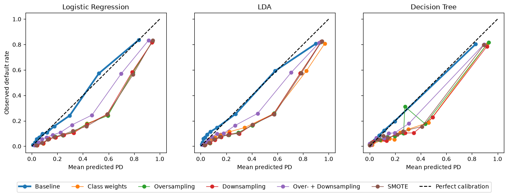

# Credit default prediction with class imbalance

## TLDR
- Logistic regression, linear discriminant analysis (LDA) and a decision tree are compared with several class imbalance remedies, using stratified cross-validation and a held-out test set.
- A decision tree with tuned complexity is the best model: Gini 0.83, KS 0.69 and average precision 0.85 on the test set, vs. approx. 0.74, 0.60 and 0.71-0.72 for logistic regression and LDA.
- Class imbalance remedies (class weights, over-/downsampling, SMOTE) do not improve how loans are ranked by risk, and they distort the predicted probabilities of default (PD): mean PD rises from approx. 21% to 27-38% for an actual default rate of 21.8%.

## Objective
Find the combination of algorithm and class imbalance remedy that predicts loan defaults most accurately, both in ranking clients by risk and in estimating their probability of default.

Lenders use such models to estimate the probability that an applicant defaults. Defaults are usually far outnumbered by repaid loans, which is commonly addressed with resampling. In credit risk, the PD value itself feeds provisions, capital and pricing, so a remedy must not distort it.

## Project overview

| | |
|-|-|
| **Problem** | Binary classification with class imbalance (1:4) |
| **Data** | 32,581 loans from Datacamp: 7,108 defaults, 25,473 non-defaults. 7 loans with implausible age or employment length (> 100 years) are dropped. |
| **Target** | `loan_status`: 1 = default, 0 = non-default |
| **Features** | Client: age, income, home ownership, employment length, previous default on file, credit history length. Loan: intent, grade (A-G), amount, interest rate, loan-to-income ratio. |
| **Pre-processing** | Mean imputation of missing values, standardization or Yeo-Johnson transform of numerical features, one-hot encoding. All steps are fitted inside the pipeline on training data only. |
| **Learning process** | Stratified 80/20 train/test split. Models are compared, hyperparameters and thresholds tuned with 5-fold stratified cross-validation on the training set. The test set is used once at the end. |
| **Algorithms** | Logistic regression, LDA, decision tree (max depth 12, min. 25 loans per leaf, tuned by grid search) |
| **Variations** | Baseline (standardization), Transform (Yeo-Johnson), and five remedies on standardized features: Class weights, Oversampling, Downsampling, Over- + Downsampling, SMOTE. Resampling runs inside an imblearn pipeline, so it only affects training folds. |
| **Thresholds** | For every model, the threshold maximizing the F-score is selected by cross-validation on the training set (`TunedThresholdClassifierCV`). |
| **Evaluation** | Ranking: Gini, KS, average precision (PR AP). Calibration: Brier score, mean PD vs. actual default rate, calibration curves. Classification: F-score, sensitivity (defaults), precision, specificity (non-defaults). |

## Results

CV PR AP: mean ± std over 5 folds on the training set. All other columns: test set (actual default rate 21.8%). Classification metrics use the threshold tuned on the training set.

### Ranking and calibration

| Model | Variation | CV PR AP | Gini | KS | PR AP | Brier | Mean PD |
|---|---|:-:|:-:|:-:|:-:|:-:|:-:|
| **Logistic Regression** | Baseline | 0.725 ± 0.005 | 0.738 | 0.600 | 0.723 | 0.103 | 21.6% |
|  | Transform | 0.715 ± 0.004 | 0.741 | 0.588 | 0.717 | 0.104 | 21.7% |
|  | Class weights | 0.716 ± 0.006 | 0.741 | 0.597 | 0.715 | 0.138 | 37.7% |
|  | Oversampling | 0.717 ± 0.006 | 0.741 | 0.598 | 0.715 | 0.138 | 37.7% |
|  | Downsampling | 0.717 ± 0.005 | 0.740 | 0.594 | 0.715 | 0.138 | 37.8% |
|  | Over- + Downsampling | 0.719 ± 0.006 | 0.740 | 0.598 | 0.719 | 0.115 | 30.6% |
|  | SMOTE | 0.719 ± 0.006 | 0.740 | 0.595 | 0.718 | 0.137 | 37.3% |
| **LDA** | Baseline | 0.708 ± 0.008 | 0.731 | 0.599 | 0.706 | 0.106 | 20.9% |
|  | Transform | 0.693 ± 0.008 | 0.732 | 0.599 | 0.699 | 0.108 | 21.2% |
|  | Class weights | 0.708 ± 0.008 | 0.731 | 0.599 | 0.706 | 0.128 | 33.5% |
|  | Oversampling | 0.716 ± 0.006 | 0.740 | 0.598 | 0.715 | 0.131 | 35.9% |
|  | Downsampling | 0.716 ± 0.005 | 0.740 | 0.598 | 0.716 | 0.132 | 36.0% |
|  | Over- + Downsampling | 0.713 ± 0.007 | 0.737 | 0.600 | 0.713 | 0.112 | 28.6% |
|  | SMOTE | 0.719 ± 0.006 | 0.740 | 0.600 | 0.718 | 0.132 | 35.7% |
| **Decision Tree** | Baseline | 0.853 ± 0.007 | 0.825 | 0.692 | 0.852 | 0.067 | 21.6% |
|  | Transform | 0.853 ± 0.007 | 0.825 | 0.692 | 0.852 | 0.067 | 21.6% |
|  | Class weights | 0.855 ± 0.007 | 0.822 | 0.680 | 0.851 | 0.089 | 31.9% |
|  | Oversampling | 0.847 ± 0.008 | 0.815 | 0.683 | 0.844 | 0.088 | 31.4% |
|  | Downsampling | 0.844 ± 0.006 | 0.811 | 0.669 | 0.830 | 0.097 | 33.4% |
|  | Over- + Downsampling | 0.845 ± 0.007 | 0.814 | 0.689 | 0.842 | 0.075 | 26.9% |
|  | SMOTE | 0.847 ± 0.008 | 0.808 | 0.685 | 0.843 | 0.082 | 29.7% |

### Classification

| Model | Variation | Threshold | F-score (0.5) | F-score | Sensitivity | Precision | Specificity |
|---|---|:-:|:-:|:-:|:-:|:-:|:-:|
| **Logistic Regression** | Baseline | 0.32 | 0.646 | 0.675 | 0.695 | 0.656 | 0.898 |
|  | Transform | 0.36 | 0.627 | 0.666 | 0.659 | 0.672 | 0.910 |
|  | Class weights | 0.68 | 0.634 | 0.671 | 0.653 | 0.691 | 0.919 |
|  | Oversampling | 0.65 | 0.634 | 0.671 | 0.678 | 0.664 | 0.904 |
|  | Downsampling | 0.65 | 0.640 | 0.669 | 0.670 | 0.668 | 0.907 |
|  | Over- + Downsampling | 0.53 | 0.672 | 0.671 | 0.678 | 0.664 | 0.904 |
|  | SMOTE | 0.66 | 0.637 | 0.672 | 0.671 | 0.673 | 0.909 |
| **LDA** | Baseline | 0.35 | 0.652 | 0.667 | 0.662 | 0.672 | 0.910 |
|  | Transform | 0.27 | 0.625 | 0.664 | 0.717 | 0.618 | 0.877 |
|  | Class weights | 0.66 | 0.656 | 0.667 | 0.665 | 0.669 | 0.908 |
|  | Oversampling | 0.65 | 0.647 | 0.673 | 0.663 | 0.683 | 0.914 |
|  | Downsampling | 0.64 | 0.648 | 0.670 | 0.667 | 0.674 | 0.910 |
|  | Over- + Downsampling | 0.53 | 0.672 | 0.671 | 0.664 | 0.678 | 0.912 |
|  | SMOTE | 0.62 | 0.646 | 0.676 | 0.695 | 0.658 | 0.899 |
| **Decision Tree** | Baseline | 0.51 | 0.781 | 0.781 | 0.676 | 0.925 | 0.985 |
|  | Transform | 0.51 | 0.781 | 0.781 | 0.676 | 0.925 | 0.985 |
|  | Class weights | 0.79 | 0.735 | 0.788 | 0.673 | 0.950 | 0.990 |
|  | Oversampling | 0.81 | 0.748 | 0.787 | 0.675 | 0.944 | 0.989 |
|  | Downsampling | 0.80 | 0.722 | 0.769 | 0.652 | 0.936 | 0.988 |
|  | Over- + Downsampling | 0.73 | 0.774 | 0.782 | 0.671 | 0.938 | 0.988 |
|  | SMOTE | 0.84 | 0.773 | 0.795 | 0.669 | 0.978 | 0.996 |

### Calibration curves (test set)

Without remedy (thick line), predicted PDs match observed default rates. Every remedy lies below the diagonal, i.e. overestimates PD.



## Key findings
- **Tree complexity matters most.** Limiting depth and leaf size raises the tree's CV average precision from 0.61 (unlimited tree) to 0.85, well above the linear models.
- **Remedies do not improve ranking.** In cross-validation, the average precision of every remedy is within approx. 0.01 of the baseline.
- **Remedies distort PD.** Every remedy inflates the mean predicted PD (27-38% vs. 21.8% actual) and worsens the Brier score, while Gini stays the same. Models trained on the original class partition are well calibrated (mean PD 20.9-21.7%).
- **Threshold tuning is the better remedy.** To classify loans, tuning the threshold reaches F-scores similar to resampling without distorting PD, e.g. baseline logistic regression goes from 0.65 at the 0.5 cutoff to 0.68.
- **Standardization is enough.** Logistic regression needs standardized features to converge (the solver did not converge on raw features even after more than 12,000 iterations). Removing skewness with a Yeo-Johnson transform does not improve the linear models further.

## Run it
```bash
uv sync
uv run python -m credit_risk.train    # full comparison, saves results, curves and PD models to artifacts/
```
`Loan_prediction.ipynb` contains the exploratory analysis and the same comparison step by step (select the `.venv` kernel).

## References
- Kuhn, M. & Johnson, K., 2013. Remedies for Severe Class Imbalance. In: Applied Predictive Modeling. New York: Springer, pp. 419-442.
- van den Goorbergh, R., van Smeden, M., Timmerman, D. & Van Calster, B., 2022. The harm of class imbalance corrections for risk prediction models: illustration and simulation using logistic regression. Journal of the American Medical Informatics Association, 29(9), pp. 1525-1534.
